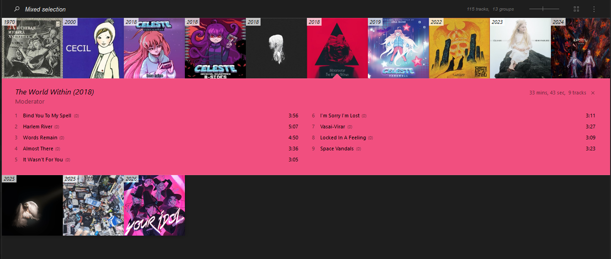

Писал скрипт под себя и буду его по мере необходимости обновлять. \
Целью было упрощение сбора локальной музыкальной библиотеки. \
Часто на ютубе можно встретить альбомы в виде отдельного видео, 
где все треки идут подряд. Но для локальной библиотеки гораздо удобней хранить у себя треки раздельно, чтобы можно было сразу включить нужный. 
Поэтому я навайбкодил этот скрипт, позволяющий одной командой скачать альбом и нарезать его в папку в виде отдельных треков с 
указанием метаданных и обложкой.

Для прослушивания я использую аудиоплеер foobar, в котором результат выглядит подобным образом:




## Принцип работы

Через yt-dlp скачивается альбом в .mp3 по ссылке на видео с ютуба. \
Для него создаётся папка с названием  "{автор альбома} - {название альбома}".\
В эту папку будут попадать отдельные .mp3 треки, полученные нарезкой скачанного альбома по
указанной информации в файле с временными метками, который нужно создавать под альбом.\
Часто под видео с популярными альбомами уже есть метки в поддерживаемом формате, которые можно просто скопировать в файл.\
Треки именуются по шаблону "{номер трека} — {название трека}.mp3"

## Формат файла временных меток

Нарезка альбома управляется файлом временных меток, указываемом через аргумент -t.

*Простейший пример вида файла временных меток*:

00:00 Сюита для лютни: Канцона и Танец \
03:55 Спандольетта \
06:04 Ave Maria \
10:15 Ричеркар 

Каждая строчка описывает отдельный создаваемый .mp3 файл с треком. В строчке сначала указывается время начала трека из альбома (допустимы форматы x:xx, xx:xx, x:xx:xx), затем разделитель (пробел, тире или длинное тире в комбинации с пробелами) и название трека.

Также можно указывать комментарии для каждого трека и перегружать метаданные альбома. 
Комментарий добавляется в конце строки после символа "|". Если внутри комментария заключены фигурные скобки, то 
они парсятся как словарь переопределений метаданных для данного трека и исключаются из комментария.

*Пример:*

00:00 Сюита для лютни: Канцона и Танец | flash warning\
03:55 Спандольетта | {artist="друг Вавилова"}\
06:04 Ave Maria | Комбинация комментария и кастомных метаданных {genre="rock?}\
10:15 Ричеркар 

Для треков внутри альбома доступны перегрузки следующих полей в метаданных:

artist \ performer; title; album; genre; comment (можно вставлять и как значение ключа);

## Зависимости

Обязательные бинарники: ffmpeg

Остальное в pyproject.toml скачивается из репозитория через

``` pip install -e . ```

## Аргументы команды

```get-music [опции]```

Основные аргументы:

Обязательные:
* -u \ --url - полная ссылка на альбом на ютубе
* -aa \ --album_artist - указание в метаданных основного автора альбома
* -a \ --album - указание в метаданных названия альбома

Необязательные:
* -t \ --timestamps - полная ссылка на альбом на ютубе. По умолчанию "timestamps.txt"
* -g \ --genre - указание в метаданных жанра альбома
* -y \ --year - указание в метаданных года выпуска альбома
* -k \ --keep-original - флаг на то, чтобы не удалять скачанный не нарезанный .mp3
* -p \ --performer - указание в метаданных исполнителя для сингла
* -c \ --cover - флаг на скачивание превью видео в квадратном формате для обложки альбома

Пример полной команды:

```get-music -aa "Владимир Вавилов" -a " Лютневая Музыка 16 - 17 веков" -y 1970 -c --url "https://www.youtube.com/watch?v=khigl3xof7E" -t "examples/timestamps-vavilov.txt" ```
